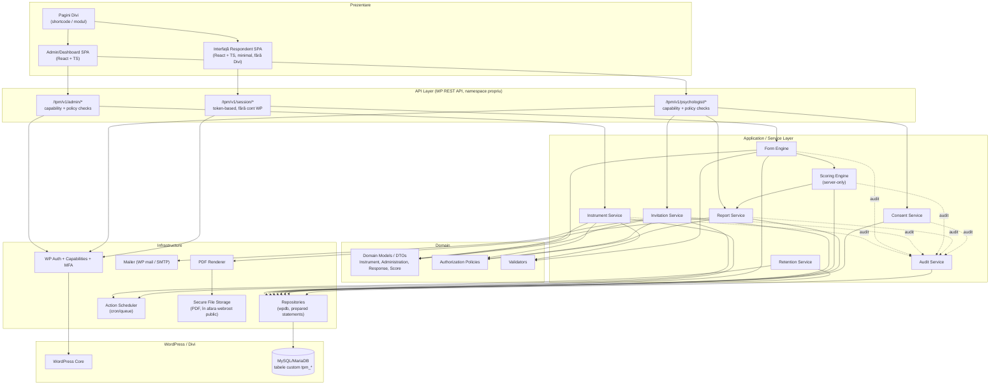
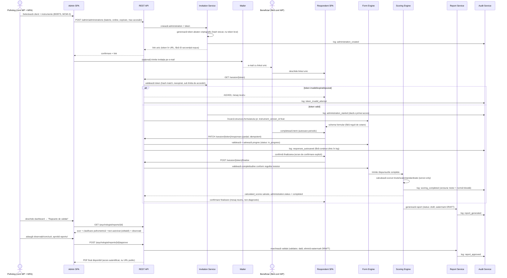

# Arhitectura recomandată

## Justificarea alegerii

Se recomandă **Varianta 1**: plugin WordPress custom, monolitic la nivel de deployment, dar
**strict stratificat intern** (separare clară Controllers / Services / Repositories / Domain /
Infrastructure), cu:

- REST API intern propriu (namespace dedicat, nu endpoint-uri publice implicite pentru date
  clinice);
- frontend React/TypeScript separat ca *cod* (pachet npm propriu, build separat), dar **servit din
  același domeniu WordPress** — combină izolarea de Divi (Varianta 2) cu simplitatea operațională
  a Variantei 1;
- schema de bază de date proiectată cu `organization_id` prezent de la primul tabel (principiul
  Variantei 4), chiar dacă în MVP există o singură organizație implicită și UI-ul nu expune
  gestiunea multi-organizație.

**De ce nu Varianta 3 (backend extern) acum:** volumul confirmat (cabinet individual/echipă mică,
fără plăți în prima versiune) nu justifică dublarea suprafeței operaționale și de securitate.
Riscul real pentru date psihologice sensibile nu vine din faptul că logica rulează „în” WordPress,
ci din calitatea implementării (capabilities, prepared statements, criptare, izolare fișiere).
Stratificarea internă riguroasă face ca, **dacă** volumul o va cere ulterior, motorul de cotare și
generarea de rapoarte să poată fi extrase într-un serviciu separat fără rescriere completă —
interfețele (Scoring Engine, Report Renderer) sunt deja definite ca și cum ar fi servicii
independente, doar că rulează in-process.

**De ce nu Varianta 2 completă (SPA găzduit separat):** ar introduce CORS/CSRF suplimentar și un
al doilea pipeline de deploy fără beneficiu real, atât timp cât frontendul e servit din același
domeniu.

## Principii arhitecturale aplicate

1. **Separarea clară a straturilor** (impusă prin namespace-uri PHP și structură de foldere —
   vezi [07-structura-repository.md](07-structura-repository.md)).
2. **Cheile de cotare, formulele și normele nu părăsesc niciodată serverul.** Frontend-ul
   respondentului primește doar: structura formularului (întrebări, tip răspuns, opțiuni,
   validări de format), nu reguli de scorare. Cotarea rulează exclusiv în
   `ScoringEngine` (PHP, server-side), apelat din controller după `POST` final, niciodată din
   JavaScript.
3. **Versionare imutabilă**: orice evaluare e legată de un `instrument_version_id` fix la
   momentul creării invitației; modificarea unui instrument creează o versiune nouă, nu editează
   una existentă folosită.
4. **Autorizare pe două niveluri**: WordPress Capabilities (poate psihologul accesa panoul?) +
   Authorization Policy custom la nivel de rând (poate *acest* psiholog accesa *acest* client/
   această evaluare?) — capabilities WP nu sunt suficiente singure pentru IDOR.
5. **Auditul e o cross-cutting concern**, nu un modul opțional — orice acțiune sensibilă trece
   printr-un `AuditService` apelat din service layer, nu din controllere individuale (ca să nu
   poată fi omis).

## Diagrama componentelor (Mermaid)

## Fluxul complet al unei evaluări (sequence diagram)

## Note privind evoluția către SaaS

Fluxul de mai sus nu se schimbă la trecerea la multi-organizație — singura diferență e că fiecare
entitate (client, instrument, administrare, raport) e deja filtrată prin `organization_id` în
Repository Layer, prin implementarea `AuthorizationPolicy`, nu prin schimbări în Service Layer.
Aceasta e exact investiția „Variantă 4” aplicată la nivel de date, fără a construi UI de
onboarding organizații, planuri sau facturare în MVP.
